[Read in English](./README.md)

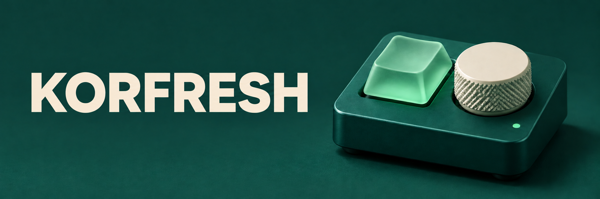

# 안녕하세요, KORFRESH입니다.

풀스택 개발자이자 IT 팀을 이끄는 리더입니다. 팀을 이끈 지 올해로 10년째입니다. 프론트엔드와 백엔드, 데브옵스를 두루 다루고 데스크톱 응용프로그램과 임베디드 시스템도 개발합니다. 여러 분야의 경험을 연결해 개발 속도를 내고, 여러 프로젝트를 동시에 추진하는 데 강점이 있습니다.

직접 쓰고 싶은 도구를 만들면서 꾸준히 배웁니다. 게임을 할 때마다 손으로 바꾸는 설정이나 일상에서 몇 번이고 되풀이하는 일이 개인 프로젝트의 출발점이 되곤 합니다.

## 기술 스택

**언어**  
 Python &nbsp; 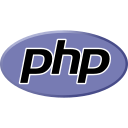 PHP &nbsp;  JavaScript &nbsp;  TypeScript &nbsp; 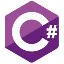 C#

| 분야 | 기술 |
| --- | --- |
| 프론트엔드 |  Vue ·  React ·  TypeScript |
| 백엔드 · API |  PHP ·  Python ( Django,  Flask) · REST API · WebSocket |
| 모바일 |  React Native · NativeScript-Vue (Android · iOS) |
| 데스크톱 |  C# · 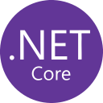 .NET · 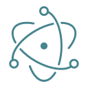 Electron |
| 데이터베이스 |  MySQL · 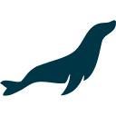 MariaDB ·  PostgreSQL ·  SQLite ·  SQL Server · 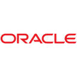 Oracle Database |
| 캐시 | 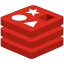 Redis |
| 운영체제 · 웹 서버 | 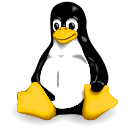 Linux ·  Windows · 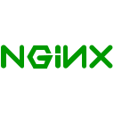 NGINX ·  Apache HTTP Server |
| 클라우드 | 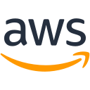 AWS (EC2, S3, RDS, Lambda, ECS) |
| 버전 관리 · 배포 |  Git ·  Docker ·  GitHub Actions ·  Jenkins |
| 테스트 | 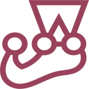 Jest |

## 게임과 도구

### Rune Hold · 룬홀드

Phaser와 TypeScript로 만든 중세 판타지 자동 전투 디펜스 게임입니다. 첫 영웅을 골라 사방에서 몰려오는 몬스터로부터 작은 오두막을 지키고, 동료를 영입해 오두막을 요새로 키워 나갑니다.

[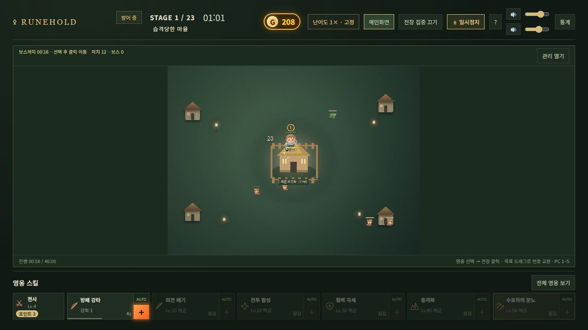](https://tegtt.me/)

**[브라우저에서 룬홀드 플레이하기 →](https://tegtt.me/)**

**[AION2 Config Switcher](https://github.com/Kor-Fresh/Aion2ConfigSwitcherRelease)** · Windows  
매번 `Engine.ini`를 찾아 편집하던 과정을 줄였습니다. 앱이 설정 파일을 찾으면 내 PC에 맞는 프리셋을 골라 적용할 수 있습니다.

**[Keyro](https://github.com/Kor-Fresh/Keyro-Releases)** · Windows x64 · Apple Silicon  
계정 정보를 카드로 정리하고 필요한 값만 골라 복사할 수 있습니다. 변경 사항은 JSON 파일에 저장하며, 두 플랫폼 모두 실행 파일을 제공합니다.

**[Fzip](https://github.com/Kor-Fresh/Fzip)** · 파일과 폴더를 압축하고 다양한 형식의 압축 파일을 풀 수 있는 Windows x64용 무료 프로그램입니다.
