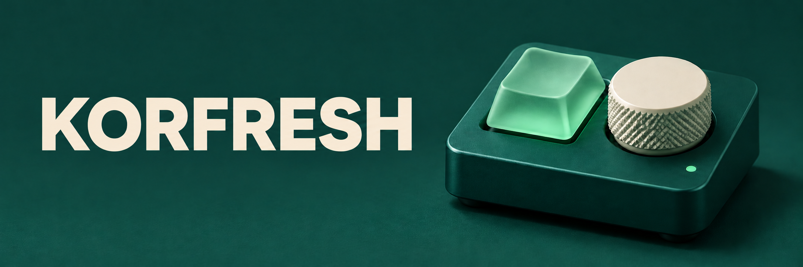
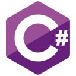
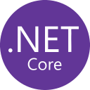
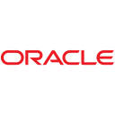
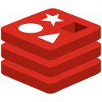
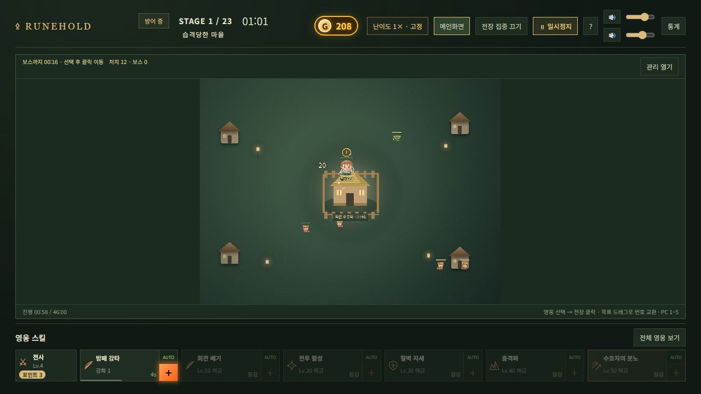

[한국어로 보기](./README.ko.md)

# Hi, I’m KORFRESH.

I’m a full-stack developer leading an IT team, now in my tenth year of team leadership. My work spans frontend, backend, and DevOps, as well as desktop applications and embedded systems. Working across those areas helps me move quickly and keep several projects moving at once.

I keep learning by building tools I want to use. Sometimes that starts with a game setting I’m tired of changing by hand. Other times it’s an everyday task I’ve repeated one time too many.

## Tech stack

**Languages**  
 Python &nbsp;  PHP &nbsp;  JavaScript &nbsp;  TypeScript &nbsp;  C#

| Area | Technologies |
| --- | --- |
| Frontend |  Vue ·  React ·  TypeScript |
| Backend & APIs |  PHP ·  Python ( Django,  Flask) · REST APIs · WebSocket |
| Mobile |  React Native · NativeScript-Vue (Android & iOS) |
| Desktop |  C# ·  .NET ·  Electron |
| Databases |  MySQL ·  MariaDB ·  PostgreSQL ·  SQLite ·  SQL Server ·  Oracle Database |
| Cache |  Redis |
| Platforms & web servers |  Linux ·  Windows ·  NGINX ·  Apache HTTP Server |
| Cloud |  AWS (EC2, S3, RDS, Lambda, ECS) |
| Version control & delivery |  Git ·  Docker ·  GitHub Actions ·  Jenkins |
| Testing |  Jest |

## Games and tools

### Rune Hold

A medieval fantasy auto-battler I built with Phaser and TypeScript. Choose your first hero, defend a cottage from waves of monsters, and recruit companions as you turn it into a fortress.

**[Play Rune Hold in your browser →](https://tegtt.me/)**

**[AION2 Config Switcher](https://github.com/Kor-Fresh/Aion2ConfigSwitcherRelease)** · Windows  
Switch AION2 settings without hunting down `Engine.ini`. The app finds the file and applies the preset you choose for your PC.

**[Keyro](https://github.com/Kor-Fresh/Keyro-Releases)** · Windows x64 & Apple Silicon  
Organize account details into cards, copy individual values, and save changes to a JSON file. Both platforms have downloadable builds.

**[Fzip](https://github.com/Kor-Fresh/Fzip)** · A free Windows x64 app for compressing files and folders and extracting archives in multiple formats.
